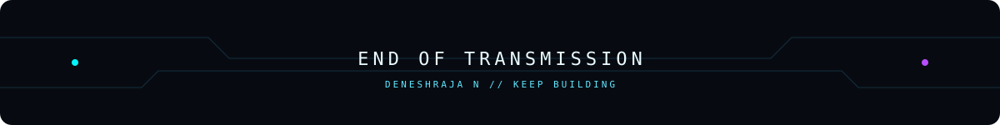

<div align="center">



<a href="https://readme-typing-svg.demolab.com">
  
</a>

<br/>

<a href="https://deneshportfolio.vercel.app"></a>
<a href="https://linkedin.com/in/deneshraja-n-a28666304"></a>
<a href="mailto:deneshraja235@gmail.com"></a>


</div>


## `01 / IDENTITY`

```text
┌──────────────────────────────────────────────────────────────┐
│  OPERATOR       DENESHRAJA N                                  │
│  SPECIALIZATION FULL STACK DEVELOPMENT                       │
│  LOCATION       CHENNAI, INDIA                                │
│  EDUCATION      BACHELOR OF COMPUTER APPLICATIONS (2025)      │
│  CURRENT ROLE   SYSTEM ADMINISTRATOR                          │
│  MISSION        TURN IDEAS INTO USEFUL DIGITAL PRODUCTS       │
└──────────────────────────────────────────────────────────────┘
```

I'm a full stack developer who enjoys turning ideas into responsive, user-friendly digital experiences. I build practical web applications end to end — from React interfaces to PHP, MySQL and Firebase backends — and enjoy solving real-world problems through technology.

- `FOCUS` — React.js, JavaScript, PHP, MySQL, Firebase and full stack web development
- `BUILDING` — Community platforms and interactive web experiences
- `EXPLORING` — Better UI systems, performance and modern web technologies
- `BASED IN` — Chennai, Tamil Nadu, India


## `02 / TECH MATRIX`

<div align="center">

**FRONTEND / INTERFACE**
<br/>


**BACKEND / DATA**
<br/>


**TOOLS / DEPLOYMENT**
<br/>


</div>


## `03 / DEPLOYED PROJECTS`

<table>
<tr>
<td width="50%" valign="top">

### `PROJECT_001` — CheyyarHub

**A digital home for a hometown.**

A community social platform built for Cheyyar, connecting local people through posts, profiles and conversations.

- React.js + Vite
- Firebase Authentication & Firestore
- Google Sign-in
- Posts, follows, chat and notifications
- Cloudinary image uploads

<a href="https://cheyyar-hub.vercel.app"><b>OPEN LIVE PROJECT ↗</b></a>

</td>
<td width="50%" valign="top">

### `PROJECT_002` — Namma Cheyyar 3D Town

**A town you can explore in a browser.**

An interactive 3D multiplayer town experience inspired by Cheyyar landmarks.

- HTML5, CSS3 and JavaScript
- Firebase Realtime Database
- Multiplayer gameplay
- Vehicles, collectibles and points
- Mobile-focused controls

</td>
</tr>
<tr>
<td width="50%" valign="top">

### `PROJECT_003` — Cheyyar Bus Timetable

**Local routes. Clear information.**

A web application presenting Cheyyar bus routes and timings.

- HTML5, CSS3 and JavaScript
- Route and timetable data
- Animated interface

</td>
<td width="50%" valign="top">

### `PROJECT_004` — HackTech Gadgets Store

**A full-stack shopping experience.**

An e-commerce project with customer and admin functionality.

- PHP and MySQL
- Product catalog and shopping cart
- Customer authentication
- Admin inventory dashboard

</td>
</tr>
</table>


## `04 / GITHUB TELEMETRY`

<div align="center">


<br/>


<br/>


</div>


## `05 / ACHIEVEMENT_ARCHIVE`

```text
[ VERIFIED ACHIEVEMENT RECORDS ]

01  FIRST PRIZE  /  STATE LEVEL
    CYBERTECH — PAPER PRESENTATION

02  FIRST PRIZE  /  INTERNATIONAL
    MEET 24 — WEB DESIGNING

03  FIRST PRIZE  /  STATE LEVEL
    TECHFEST — WEB DESIGNING

TOTAL RECOGNITIONS: 03 FIRST-PRIZE AWARDS
```


## `06 / CONNECTION PORT`

<div align="center">

**HAVE AN IDEA? LET'S BUILD SOMETHING USEFUL.**

<a href="https://deneshportfolio.vercel.app"></a>
<a href="https://linkedin.com/in/deneshraja-n-a28666304"></a>
<a href="mailto:deneshraja235@gmail.com"></a>

<br/><br/>

`THINK IN SYSTEMS. BUILD WITH PURPOSE. SHIP WITH PRIDE.`



</div>
