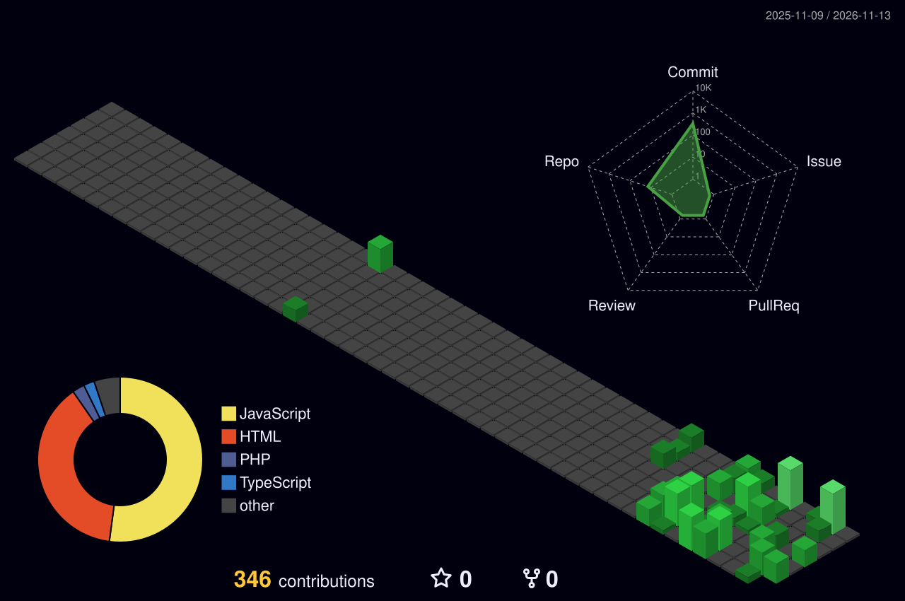

<!-- ===== ANIMATED HEADER ===== -->

  

  

  
  
  
  

<!-- ===== ANIMATED TERMINAL (custom SVG in /assets) ===== -->

  

---

## 📈 At a Glance

  
  
  
  

- 📍 **Chennai, India** · Fresher · **Full Stack Developer**
- 🎓 **Bachelor of Computer Applications**, Adhiparasakthi College of Arts and Science, Ranipet (2022 – 2025)
- 💼 **System Administrator**, Voltech Engineers Pvt. Ltd., Chennai (May 2026 – Present)
- 🏆 **3x First Prize** at state and international technical events
- 🎯 Looking for an **entry-level Frontend / Full Stack Developer** role

---

## 🧰 Skills

  

  

Core concepts: REST APIs · Authentication · CRUD · Responsive Design · SQL · Git

---

## 🚀 Featured Projects

<table>
  <tr>
    <td width="50%" valign="top">
      <h3>🏘️ CheyyarHub</h3>
      
Hyper-local community app with Google sign-in, posts, follow requests, real-time chat, notifications and a developer panel.

      
      
      
      
        
      <a href="https://github.com/Denesh-developer">Code</a> · <a href="https://cheyyar-hub.vercel.app">Live Demo</a>
    </td>
    <td width="50%" valign="top">
      <h3>🎮 Namma Cheyyar 3D Town</h3>
      
Explorable 3D town in the browser with a theatre box office, drivable vehicles, collectible coins and online multiplayer.

      
      
        
      <a href="https://github.com/Denesh-developer">Code</a> · <a href="https://cheyyar-3d.vercel.app">Live Demo</a>
    </td>
  </tr>
  <tr>
    <td width="50%" valign="top">
      <h3>🚌 Cheyyar Bus Timetable</h3>
      
All bus stand routes and timings in one clean, animated and responsive web app.

      
      
      
        
      <a href="https://github.com/Denesh-developer">Code</a> · <a href="https://cheyyar-bus.vercel.app">Live Demo</a>
    </td>
    <td width="50%" valign="top">
      <h3>🛒 HackTech Gadgets Store</h3>
      
Full-stack e-commerce app with product catalog, cart, customer authentication and admin inventory dashboard.

      
      
      
        
      <a href="https://github.com/Denesh-developer?tab=repositories">Code</a>
    </td>
  </tr>
</table>

---

## 🏆 Certifications & Achievements

- 🥇 **1st Prize, Paper Presentation**: CyberTech, State Level Technical Symposium, Thiruvalluvar Arts and Science College
- 🥇 **1st Prize, Web Designing**: IT Meet 24, International Conference, KMG College of Arts and Science
- 🥇 **1st Prize, Web Designing**: TechFest, State Level Technical Symposium, Indo American College
- 📘 **Higher Grade Typewriting** (English and Tamil) · **Computer Office Automation** (Passed)

  

---

## 📊 GitHub Analytics

  
  

  

  

### 🐍 Contribution Snake

  <picture>
    <source media="(prefers-color-scheme: dark)" srcset="https://raw.githubusercontent.com/Denesh-developer/Denesh-developer/output/github-contribution-grid-snake-dark.svg" />
    <source media="(prefers-color-scheme: light)" srcset="https://raw.githubusercontent.com/Denesh-developer/Denesh-developer/output/github-contribution-grid-snake.svg" />
    
  </picture>

### 🧊 3D Contributions

<!-- Generated by .github/workflows/profile-3d.yml -->

  

---

## 💡 Dev Quote

  

## 📫 Let's Connect

  
  
  
  

  

