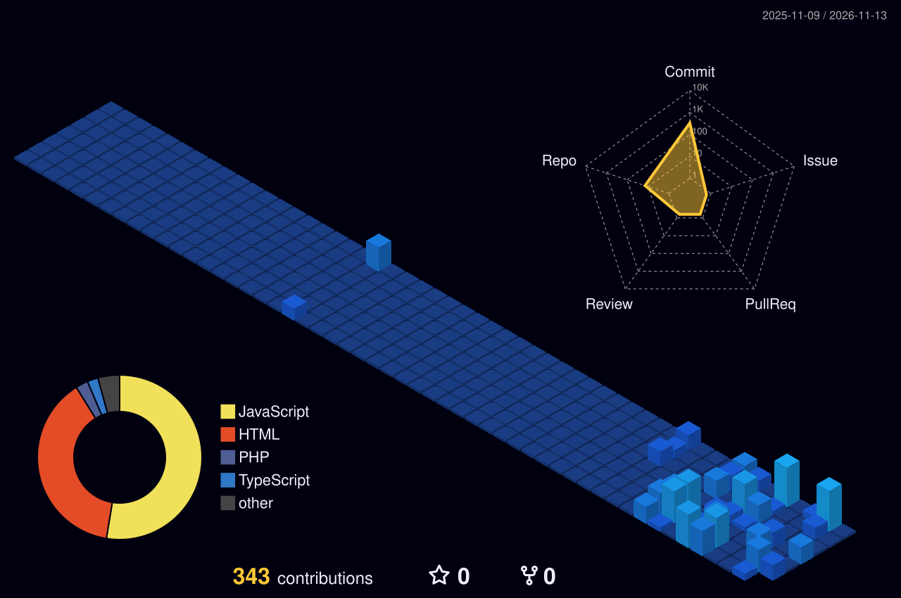

<!-- Animated wave header -->
<div align="center">
  
</div>

<!-- Typing animation -->
<div align="center">
  
</div>

<p align="center">
  <a href="https://denesh-developer.github.io/Portfolio"></a>
  <a href="https://linkedin.com/in/deneshraja-n-a28666304"></a>
  <a href="mailto:deneshraja235@gmail.com"></a>
  
</p>

---

## 👨‍💻 About Me

```js
const denesh = {
  name: "Deneshraja N",
  role: "Frontend Developer",
  education: "BCA (2025) – Adhiparasakthi College of Arts and Science",
  location: "Tamil Nadu, India 🇮🇳",
  currentlyWorking: "System Administrator @ Voltech Engineers, Chennai",
  skills: ["HTML5", "CSS3", "JavaScript", "React.js", "Firebase"],
  achievements: "3x 1st Prize – State & International tech events 🏆",
  lookingFor: "Entry-level Frontend Developer role"
};
```

- 🚀 Shipped **CheyyarHub** – a live React + Firebase app with Google sign-in, deployed on Vercel
- 🛠️ Hands-on with system & network administration
- 🌱 Always learning, always building

---

## 🧰 Tech Stack

<p align="center">
  
</p>

---

## 🚀 Featured Projects

<table>
  <tr>
    <td width="50%" valign="top">
      <h3>🏘️ CheyyarHub</h3>
      <p>Hyper-local community web app with secure Google sign-in and Firestore data.</p>
      
      
      <br/><br/>
      <a href="https://cheyyar-hub.vercel.app">🔗 Live Demo</a>
    </td>
    <td width="50%" valign="top">
      <h3>🛒 HackTech Gadgets Store</h3>
      <p>Full-stack e-commerce: catalog, cart, customer auth and admin inventory dashboard.</p>
      
      
      
    </td>
  </tr>
  <tr>
    <td width="50%" valign="top">
      <h3>📅 Event Management System</h3>
      <p>Responsive frontend showing event schedules and details, built with semantic HTML, Flexbox and CSS3.</p>
      
      
    </td>
    <td width="50%" valign="top">
      <h3>📂 More on GitHub</h3>
      <p>Check my repositories for more work.</p>
      <a href="https://github.com/Denesh-developer?tab=repositories">🔗 View all repositories</a>
    </td>
  </tr>
</table>

---

## 🏆 Achievements

| 🥇 | Event | Category |
|----|-------|----------|
| 1st Prize | CyberTech – State Level Symposium | Paper Presentation |
| 1st Prize | Data Science & IT Meet 24 – International Conference | Web Designing |
| 1st Prize | TechFest – State Level Symposium | Web Designing |

---

## 📊 GitHub Stats

<p align="center">
  
  
</p>

<p align="center">
  
</p>

---

## 🧊 3D Contribution Graph

<!-- Generated automatically by the GitHub Action in .github/workflows/profile-3d.yml -->
<p align="center">
  
</p>

## 🐍 Contribution Snake

<p align="center">
  
</p>

---

<div align="center">
  
  <br/>
  <b>⭐ Thanks for visiting! Let's build something awesome together. ⭐</b>
</div>
